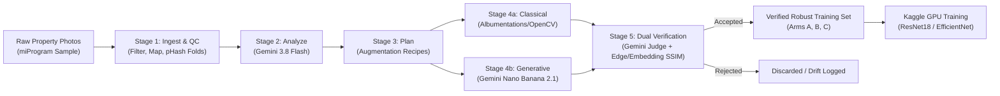

# ListingAugment AI: Property Photo Augmentation Pipeline

[](https://www.python.org/)
[](docs/source_verification.md)

**Domain:** Residential Real Estate Property Condition Assessment  
**Core Problem:** Property condition assessment models must reliably evaluate real-world photos taken under awkward lighting, dim evening conditions, and handheld angles. However, training sets consist primarily of clean, professional inventory photos.  
**Solution:** A robust photo augmentation and verification pipeline that synthesizes realistic smartphone lighting and camera-angle variations while strictly preserving defect and condition labels.

---

## License Notice

The primary dataset is derived from the **miProgram UK Residential Property Inspection Sample** provided by Mobile Inventory Program Limited:
> *This sample dataset is provided for evaluation and research purposes only. Commercial use requires a separate written licence agreement with Mobile Inventory Program Limited. Redistribution of this sample, in whole or in part, is not permitted.*

Images are downloaded at setup time using `scripts/download_data.py` and are **never** committed or redistributed in this repository.

---

## System Architecture



---

## Quickstart & Reproduction

### 1. Installation
Clone repository and install dependencies in a virtual environment:
```bash
python3 -m venv .venv
source .venv/bin/activate
pip install -r requirements.txt
```

### 2. Download Data & Build Manifest
```bash
# Download the 423 miProgram inspection photos & metadata JSONs
python scripts/download_data.py

# Build manifest.csv, filter rated elements, map labels, run near-duplicate audit
python scripts/build_manifest.py
```

### 3. Generate Secondary Synthetic Stress Set
```bash
python scripts/generate_synthetic_stress.py
```

### 4. Run Benchmark
```bash
# Zero-thermal strain feature evaluation across 5 folds and 3 seeds
python scripts/run_benchmark.py
```

### 5. Launch Interactive Streamlit Demo
```bash
streamlit run app/streamlit_app.py
```

---

## Training on Kaggle GPU (Hardware-Friendly)

To protect your personal laptop hardware, full backpropagation and deep convolutional fine-tuning are designed to run on Kaggle GPU:

1. **Option A (Quick Upload):**
   - Open Kaggle Notebooks -> *New Notebook*
   - Upload [`notebooks/kaggle_training.ipynb`](notebooks/kaggle_training.ipynb)
   - Set Accelerator to **GPU T4** or **P100**
   - Click **Run All**

2. **Option B (Full Bundle):**
   - Run `python scripts/package_for_kaggle.py` to create `kaggle_listingaugment_bundle.zip`
   - Upload the zip to Kaggle as a private Dataset or Notebook file
   - Run complete multi-arm cross-validation directly in the cloud.

---

## Verification & Documentation

- [Source Verification Report (`docs/source_verification.md`)](docs/source_verification.md): Verification of datasets, card discrepancies, and API model specifications.
- [Experimental Results (`docs/results.md`)](docs/results.md): Accuracy, macro-F1, robustness gap, and bootstrap 95% confidence intervals across Arms A, B, and C.
- [Project Limitations (`docs/limitations.md`)](docs/limitations.md): Analysis of small labeled sample size, class imbalance, and intra-property leakage.
- [Project Changelog (`CHANGELOG.md`)](CHANGELOG.md): Complete chronological record of design choices and execution stages.

